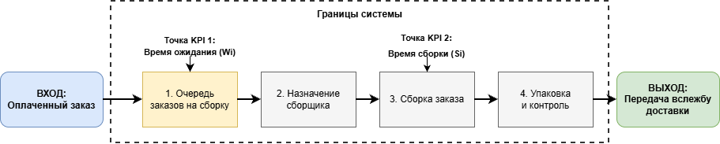
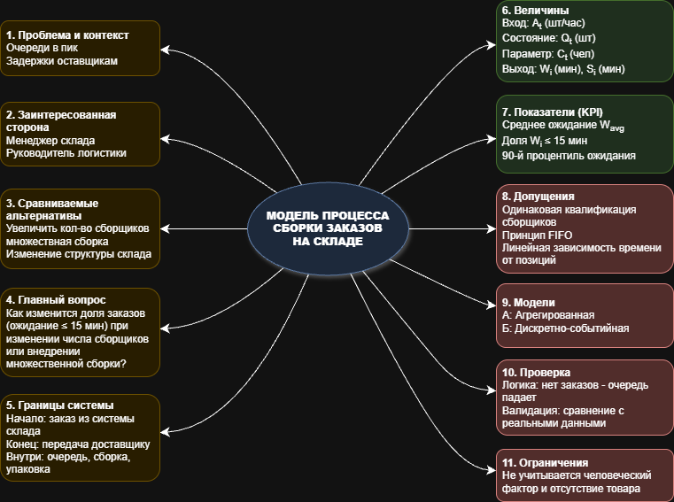

# Моделирование информационного процесса сборки заказов на складе интернет-магазина

**Дисциплина:** Модели информационных процессов и систем

## Цель работы
Переход от неформального описания проблемной ситуации к постановке задачи для последующего моделирования

## Краткое описание проблемы
В качестве проблемы выбран процесс обработки и сборки заказов на складе интернет-магазина. Проблема заключается в образовании очередей и задержках в часы пик. Рассматриваются альтернативные решения: увеличение количества сборщиков или внедрение множественной сборки заказов.

## Представленные материалы
- "Стукалин ДЭ 37-26 МИСП.docx" - описание модели, включая KPI, допущения, ограничения и варианты моделей.
- "Процесс обработки и сборки заказов.png" - схема информационного процесса с границами и точками KPI.
- "Ментальная карта.png" - Ментальная карта представленной системы.

## Основные элементы
- **Главный вопрос:** Как изменится доля заказов, ожидающих сборки не более 15 минут, при изменении числа сборщиков или внедрении пакетной сборки?
- **KPI:** Среднее время ожидания, доля заказов собранных в срок (≤ 15 мин), 90-й процентиль ожидания.
- **Модели:** Агрегированная балансовая модель (Вариант А) и Дискретно-событийная имитационная модель (Вариант Б).

### Диаграмма информационного процесса

### Ментальная карта

